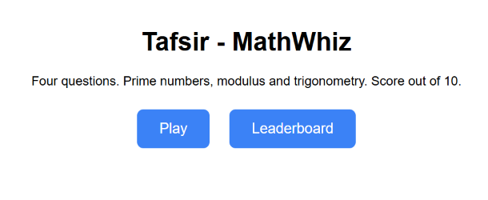
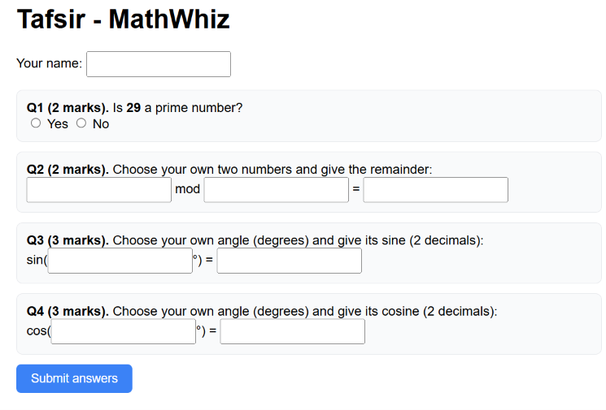
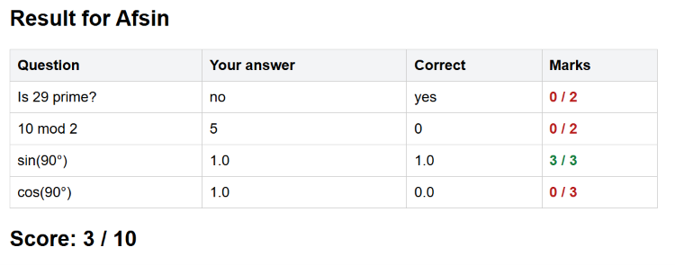
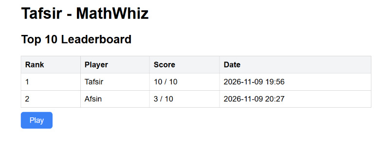

# Tafsir - MathWhiz

A four-question mathematical game built with Java Servlets, JDBC and PostgreSQL.
The player chooses the numbers and angles for the modulus and trigonometry questions, and every answer is checked by real Java calculations
(`MathUtil.java`), then the score (out of 10) is saved to the database and shown on a Top 10 leaderboard.

## Features
- Four questions per game: prime number (random), modulus, sine, cosine (numbers and angles typed by the player)
- Score calculation out of 10 marks
- JDBC with `PreparedStatement` for saving and reading scores
- Top 10 leaderboard sorted by score (earlier play wins ties)
- The prime-question number is kept in the server session, so it cannot be tampered with

## Scoring
| Question | Method | Marks |
|----------|--------|-------|
| Q1: Is N prime? | `MathUtil.isPrime(int)` | 2 |
| Q2: player enters A and B, answers A mod B | `MathUtil.modulus(int, int)` | 2 |
| Q3: player enters an angle, answers sin(angle) | `MathUtil.sine(int)` | 3 |
| Q4: player enters an angle, answers cos(angle) | `MathUtil.cosine(int)` | 3 |
| **Total** | | **10** |

Trigonometric answers are accepted within 0.01 of the correct value (2 decimal places).

## Project structure
```
MathWhiz/
├── pom.xml
├── schema.sql
├── README.md
├── screenshots/
└── src/main
    ├── java/mathwhiz
    │   ├── MathUtil.java          (prime, modulus, sine, cosine)
    │   ├── Db.java                (JDBC: save score, top 10)
    │   ├── Ui.java                (HTML helpers)
    │   ├── GameServlet.java       (/game)
    │   └── LeaderboardServlet.java(/leaderboard)
    └── webapp/index.html
```

## Requirements
- JDK 17+
- Maven 3.8+
- Apache Tomcat 10.1+ (Jakarta Servlet 6)
- PostgreSQL

## Setup
1. Create the database and table:
   ```
   psql -U postgres -f schema.sql
   ```
2. Check the connection settings in `Db.java` (defaults: `localhost:5432`, database `mathwhiz`,
   user `postgres`, password `admin123`). You can override them with the environment variables
   `DB_URL`, `DB_USER` and `DB_PASSWORD`.
3. Build:
   ```
   mvn clean package
   ```
4. Copy `target/MathWhiz.war` into Tomcat's `webapps` folder and start Tomcat.
5. Open http://localhost:8080/MathWhiz/

## How to play
1. Click **Play**, enter your name, answer Q1, then type your own two numbers for Q2 and your own angles for Q3 and Q4, each with your answer.
2. Submit. Java calculates the correct answers and shows them, your marks and your score out of 10.
3. Your score is saved and the Top 10 leaderboard is displayed.

## Screenshots
### Home Page

### Game Page

### Result Page

### Leaderboard

